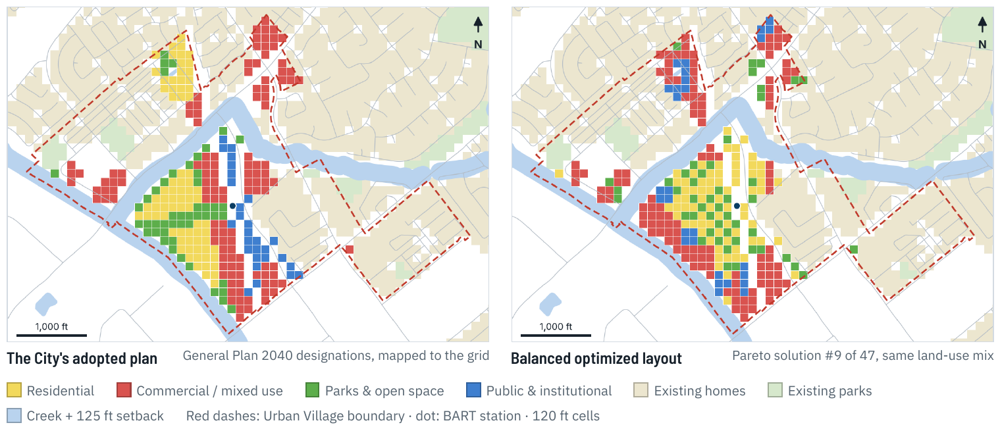

# Berryessa BART Urban Village: Land Use Optimization with GIS

I took the NSGA-III optimizer from my [Senior Synthesis capstone](https://github.com/Kyler-Kasravi/nsga3-land-use-optimization) and applied it to real land: the redevelopable parcels around the Berryessa / North San Jose BART station.

I wanted to find if the optimizer was capable of performaing well on real plots of land, and if so, could it find layouts that do better on walking access and livability using my objective functions than the city's general plan?



## Results (seed 7, 300 generations)

The optimizer found 47 trade-off layouts. 41 of them beat the City's plan on both walk to schools/services and livability, and all 47 shorten the walk from new homes to BART. The plan still does better on walks to jobs and keeps more new homes out of the flood zone and rail noise contour. T

| Metric | Balanced layout | Best of 47 | City's plan |
|---|---|---|---|
| Avg. walk, home to nearest job | 2,100 ft | 2,080 ft | 2,022 ft |
| Avg. walk, home to school / services | 2,685 ft | 2,357 ft | 2,873 ft |
| Livability score (higher is better) | 1,174 | 1,181 | 1,139 |
| Avg. walk, new homes to BART | 938 ft | 861 ft | 1,628 ft |

Four other random seeds gave similar results (35 to 46 layouts beat the plan each time). With strict rules (no new homes in the flood zone or noise contour) the advantage goes away, since the land next to the station falls inside both.

The optimized layouts score better than the City's plan on the objective functions I wrote: walking distance to schools and services, livability, and walking distance from new homes to BART. While the results score better according to these objective functions, that doesn't mean a better plan, and I'm not claiming to have found one. My model measures a few things that fit on a 120 ft grid with one use per cell. The City's plan also has to take into account what my model leaves out, such as building heights and densities, cost and market demand, streets and utilities, flood risk, noise mitigation, and community input. The comparison also rests on my own choices. For example, I count the plan's Urban Village land as commercial, which tilts it toward jobs and away from housing.

This is a proof of concept and a passion project. I wanted to see whether the optimizer from my capstone could work on real land, and whether it would find arrangements worth a closer look.
## Method

- **Data:** City of San Jose (Urban Village boundary, General Plan 2040, parcels, zoning, streets, creeks, noise contours, parks, schools), FEMA flood zones, 2020 Census blocks, Caltrans GTFS stops, and OpenStreetMap. Every layer is frozen and listed in `data/manifest.csv` with source, date, CRS and license.
- **Grid:** 59 x 45 cells of 120 ft in EPSG:2227. Roads, rail, creek setbacks and the floodway are unbuildable; existing homes, parks and schools stay fixed; 269 redevelopable cells (parking, the flea market, vacant or under 30% built).
- **Rules as geometry:** creek setback, FEMA floodway, 1% flood zone and rail noise contour.
- **Walking distances:** along real streets and paths (Dijkstra on a 34,204-node network), not straight lines.
- **Optimization:** NSGA-III (pymoo) with my cluster-growth encoding and four objectives: walk to jobs, walk to services, livability, and walk from new homes to BART. The City's plan is scored with the same functions.
- **QA/QC:** 22 automated checks, including OSM vs. City parcels, General Plan, GTFS stops and creeks.
- **Outputs:** one GeoPackage with styled layers, a QGIS project with a nine-map series and QA error atlas, and a Leaflet web map.

## Data flow

```
fetch_osm_site.py  -> site_osm.json                     (frozen)
fetch_official.py  -> data/raw/*.geojson, manifest.csv  (frozen)
        |
site_pipeline.py  (+ official_data.py, site_rules.py, walk_network.py, Nsga3 Z.py)
        |
berryessa.gpkg
        +-> gis_qaqc.py         QA layers, qa_summary.csv
        +-> make_webmap.py      webmap/index.html
        +-> qgis_site_map.py    QGIS project, maps 01-09
        +-> qgis_qaqc_review.py QA review forms, error atlas
        +-> scenarios.py        other seeds and what-if runs
        +-> run_demo.py         checks against expected_results.json, writes demo_report.html
```

## Running it

Windows: install QGIS, run `setup_env.bat` once, then `run_demo.bat` (about 10 minutes, or `run_demo.bat --quick` for about 3).

macOS / Linux:

```
python3 -m venv .venv && .venv/bin/pip install -r requirements.txt
.venv/bin/python run_demo.py --no-maps     # maps need QGIS's Python
```

Inputs are frozen and the seed is fixed, so each run compares itself to `expected_results.json` and reports PASS or the differences. Use `--fetch` to download fresh data (the numbers will then differ).

## Notes

This is an illustrative planning exercise on a 120 ft grid (one use per cell, no densities), not an adopted or proposed plan.

Data: City of San Jose GIS, FEMA NFHL, US Census Bureau, Caltrans, (c) OpenStreetMap contributors.
